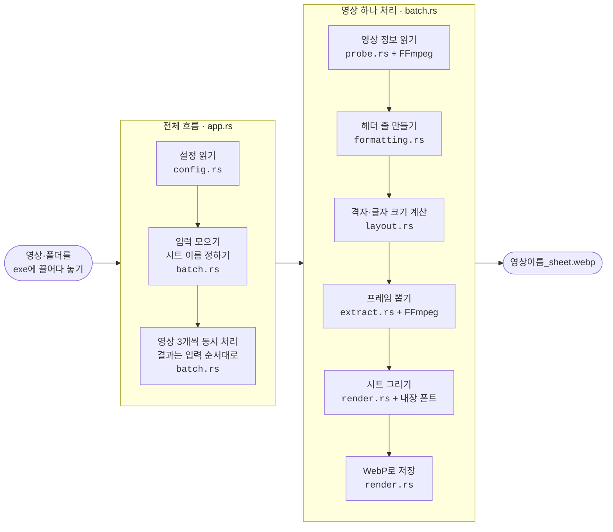

# VidGlance (Rust)

[English](README.md) | **한국어**

영상 파일을 `VidGlance.exe` 위로 끌어다 놓으면, 같은 폴더에 **한 장짜리 썸네일 시트**(`영상이름_sheet.webp`)를 만드는 Windows 도구입니다. [Python 버전 VidGlance](https://github.com/0eti/VidGlance)를 Rust로 다시 만든 것으로, 기능과 시트 모양은 같습니다.

- 위쪽에 영상 정보: 파일명, 크기, 해상도(비율), fps, 비디오·오디오 코덱, 재생 시간
- 아래에 4×5 격자 프레임과 칸마다 타임스탬프
- 여러 영상과 폴더를 한꺼번에 처리하고, 한글 파일명·경로를 지원합니다

VidGlance가 지키는 세 가지:

- **범용성:** 확장자와 코덱을 가리지 않습니다. mp4·mkv·avi·mov·webm·ts 등과 H.264·HEVC·VP9·AV1 등 FFmpeg가 읽는 영상이면 됩니다.
- **간편성:** 끌어다 놓기 한 번이면 끝입니다. 설치도, 다른 프로그램도 필요 없는 exe 하나입니다.
- **신속성:** 같은 일을 하는 어떤 프로그램보다 빠르게 만듭니다. 아래 [속도 비교](#속도-비교)를 보세요.

## Python 버전과 다른 점

| | Python 0.1.1 | Rust 0.2.4 |
|---|---|---|
| 배포 | onefile 82MB 또는 onedir 폴더 210MB | **exe 하나 24MB** (FFmpeg·dav1d·폰트 포함, 다른 DLL 필요 없음) |
| 시작 | onefile 약 4~5초, onedir 0.3초 | **0.02초** |
| 4K AV1 영상 1개 | onedir 약 1.1초 | **약 0.3초** |
| 4K AV1 영상 5개 한꺼번에 | onedir 약 5.4초 | **약 1.2초** (3개씩 동시에 처리) |
| 1080p H.264 60초 (키프레임 8초 간격) | onedir 약 2.6초 | **약 1.3초** |
| 9.6GB fragmented MP4 (3시간 27분) | onedir 약 4.1초 | **약 1.2초** |
| 설정 파일 위치 | exe 옆 `config.json` | **항상 `%APPDATA%\VidGlance\config.json`** (exe 옆에는 만들지 않음) |
| 영상 정보 | ffprobe.exe 실행 | exe 안의 FFmpeg 라이브러리로 직접 읽음 (`ffmpeg_dir` 설정·`--ffmpeg-dir` 없음) |

Python 버전의 `config.json`을 `%APPDATA%\VidGlance\`에 복사해도 그대로 쓸 수 있습니다(`ffmpeg_dir`은 경고 없이 무시). 타임스탬프 위치(`timestamp_position`)는 Rust 버전에만 있습니다.

## 사용법

1. `VidGlance.exe`를 원하는 폴더에 둡니다.
2. 영상 파일(여러 개 가능)이나 폴더를 **`VidGlance.exe` 아이콘 위로 끌어다 놓습니다.**
3. 각 영상과 같은 폴더에 `영상이름_sheet.webp`가 생깁니다. 모두 성공하면 3초 뒤 창이 저절로 닫히고, 실패가 있으면 이유를 보여 준 뒤 키 입력을 기다립니다.

- 여러 영상은 3개씩 동시에 처리하고, 결과는 놓은 순서대로 보여 줍니다.
- 이미 시트가 있는 영상은 건너뜁니다(`overwrite`로 바꿀 수 있음).
- 같은 폴더에 이름이 같고 확장자만 다른 영상(`a.mkv`, `a.mp4`)이 있으면 이름 순으로 `a_sheet.webp`, `a_sheet(2).webp`…가 됩니다. 다시 실행해도 같은 이름이라 이미 만든 시트는 건너뜁니다. 같은 이름의 자막·사진(`a.ass`, `a.jpg`)을 함께 끌어다 놓아도 영상 시트 이름은 바뀌지 않습니다.
- 폴더를 놓으면 그 안의 영상(`mp4 mkv avi mov wmv flv webm m4v ts m2ts mpg mpeg 3gp`)만 처리합니다. 하위 폴더는 `recursive`가 `true`일 때만.
- 파일을 직접 놓으면 확장자와 관계없이 열어 봅니다. 자막·문서·사진처럼 영상이 아닌 파일은 "영상 아님"으로 건너뜁니다.
- exe를 **더블클릭**하면 설정 파일 위치를 알려 줍니다(없으면 만듭니다).

> 서명되지 않은 exe라서 처음 실행할 때 Windows SmartScreen 창이 뜰 수 있습니다. **추가 정보 → 실행**을 누르면 됩니다.

## 설정 (`%APPDATA%\VidGlance\config.json`)

탐색기 주소창에 `%APPDATA%\VidGlance`를 입력하면 폴더가 열립니다. 메모장으로 고친 뒤 저장하면 다음 실행부터 반영됩니다. 다른 설정 파일을 쓰려면 `--config 경로`를 붙입니다.

```json
{
  "config_version": 1,
  "columns": 4,
  "rows": 5,
  "width": 1024,
  "gap": 8,
  "theme": "light",
  "language": "en",
  "header": {
    "file_name": true,
    "size": true,
    "resolution": true,
    "fps": true,
    "video_codec": true,
    "audio_codec": true,
    "duration": true
  },
  "format": "webp",
  "quality": 85,
  "suffix": "_sheet",
  "output_dir": "",
  "overwrite": false,
  "show_timestamp": true,
  "timestamp_position": "bottom-right",
  "recursive": false,
  "skip_start_seconds": 0,
  "skip_end_seconds": 0,
  "seek_mode": "fast",
  "font": "",
  "close_delay_seconds": 3
}
```

| 키 | 뜻 | 허용 값 |
|---|---|---|
| `columns`, `rows` | 격자 열·행 수 | 1–20 |
| `width` | 시트 가로 크기(px) | 320–8000 |
| `gap` | 칸 사이 간격(px) | 0–100 |
| `theme` | 밝은 배경 / 어두운 배경 | `"light"` / `"dark"` |
| `language` | 헤더 레이블 언어 | `"en"` / `"ko"` |
| `header.*` | 헤더 항목별 표시 여부. 모두 `false`면 헤더 없이 격자만 | `true` / `false` |
| `format` | 저장 형식 | `"webp"` / `"jpg"` / `"png"` |
| `quality` | 압축 품질 (png는 무시) | 1–100 |
| `suffix` | 출력 파일명 꼬리 | 비어 있지 않은 문자열. `< > : " / \ \| ? *` 금지 |
| `output_dir` | 저장 폴더. 비우면 영상 폴더, 상대 경로면 각 영상 폴더 기준 | 경로 |
| `overwrite` | 이미 있는 시트를 덮어쓸지 | `true` / `false` |
| `show_timestamp` | 칸마다 타임스탬프를 그릴지 | `true` / `false` |
| `timestamp_position` | 칸 안 타임스탬프 위치 | `"bottom-right"` / `"bottom-left"` / `"top-right"` / `"top-left"` / `"center"` |
| `recursive` | 폴더를 놓았을 때 하위 폴더까지 | `true` / `false` |
| `skip_start_seconds`, `skip_end_seconds` | 앞·뒤에서 뺄 구간(초) | 0 이상 |
| `seek_mode` | `fast`는 균등 시점에서 가장 가까운 키프레임(빠름, 오차 보통 1~3초). 키프레임이 칸 간격의 절반이나 10초보다 멀면 그 칸만 정확한 시점으로 뽑습니다. `accurate`는 항상 정확한 시점(느림). 타임스탬프는 항상 실제 장면 시각 | `"fast"` / `"accurate"` |
| `font` | 글꼴 파일 경로. 비우면 맑은 고딕 → 내장 Pretendard | 경로 |
| `close_delay_seconds` | 모두 성공했을 때 창이 닫히기까지 초. 0이면 바로, 음수면 항상 키 대기 | 정수 |

JSON에서 Windows 경로의 `\`는 `\\`로 두 번 쓰거나 `/`를 씁니다: `"output_dir": "D:/썸네일"`.

## 명령줄 옵션

지정한 옵션은 이번 실행에서만 설정을 덮어씁니다. 명령줄에서 실행하면 끝나고 창이 기다리지 않습니다.

```
VidGlance.exe [옵션] <파일 또는 폴더...>

  -g, --grid CxR         격자 (예: 5x6)
  -w, --width PX
      --gap PX
      --theme THEME      light | dark
      --lang LANG        en | ko
  -o, --output-dir DIR
  -r, --recursive
      --format FMT       webp | jpg | png
      --quality N
      --overwrite
      --no-timestamp
      --font PATH
      --seek MODE        fast | accurate
      --config PATH      설정 파일 직접 지정
      --no-pause         끝나고 기다리지 않음
  -q, --quiet            요약만 출력
  -v, --verbose          FFmpeg 버전·폰트·단계별 시간 출력
  -V, --version
```

종료 코드: `0` 모두 성공 또는 건너뜀, `1` 하나 이상 실패, `2` 설정 오류·잘못된 옵션.

## 속도 비교

썸네일 시트를 만드는 Windows 프로그램들과 같은 영상, 같은 조건으로 비교했습니다 (2026-10-28).

- **조건:** 4×5 격자, 너비 1024px. 정확히 맞출 수 없는 프로그램은 가장 가까운 값으로 맞췄습니다 (VTM 1023px, 팟플레이어 1018px, vcsr 1051px).
- **잰 시간:** 프로그램 시작부터 시트 저장까지, 2번 재서 빠른 쪽. 팟플레이어만 예외입니다(아래 참고).
- **PC:** Intel Core i5-9300HF(4코어 8스레드), 메모리 32GB, SSD, Windows 11

| 영상 | 내용 |
|---|---|
| 4K AV1 | 3840×1920 23.98fps, 62~188MB, 5개 (YouTube에서 받은 영상) |
| H.264 60초 | 1920×1080 30fps 시험 패턴, 키프레임 8.3초 간격 |
| fragmented MP4 | 1920×1080 H.264 + AAC, 3시간 27분, 9.6GB, 색인 없이 조각 13,439개 (방송 녹화) |

**영상 하나에 걸린 시간 (초, 작을수록 빠름)**

| 프로그램 | 4K AV1 (5개 평균) | H.264 60초 | fragmented 9.6GB | 비고 |
|---|---|---|---|---|
| **VidGlance (Rust) 0.2.2** | **0.23** | **1.33** | **1.09** | jpg로 저장하면 0.18 / 1.20 / 1.01 |
| VidGlance (Python) 0.1.1 onedir | 1.10 | 2.70 | 4.06 | |
| mtn 3.5.0 (`-z -b 2 -D 0`) | 0.63 | 0.17 ※ | 1.78 | 키프레임만 사용. 헤더의 한글 깨짐, WebP 저장 없음 |
| mtn 3.5.0 기본값 | 17.64 | 3.88 | 1.80 | 검은 화면·윤곽 검사가 느림 |
| vcsi 7.0.17 `--fast` | 7.31 | 3.65 | 41.4 | 칸마다 ffmpeg 실행 |
| vcsi 7.0.17 기본값 | 8.66 | 4.93 | 37.6 | |
| vcsr 0.6.0 (vcsi의 Rust판) | 7.06 | 2.91 | 39.5 | `--fast`도 거의 같음 |
| ffmpeg 9.0.2 키프레임만 + tile | 1.08 | 0.18 ※ | 29.3 | 헤더·타임스탬프 없음 |
| ffmpeg 9.0.2 칸마다 `-ss` | 8.98 | 3.67 | 33.7 | 헤더·타임스탬프 없음 |
| ffmpeg 9.0.2 전체 디코딩 + tile | 37.6 | 1.35 | 739 | 헤더·타임스탬프 없음 |
| MPC-HC 2.8.4 (`/thumbnails`) | 6.08 | 6.99 | 8.89 | 재생기를 통째로 띄워 칸마다 한 프레임씩 넘김 |
| Video Thumbnails Maker 28.0 | 11.99 | 5.29 | 34.97 | 무료판은 칸 하나에 광고 그림, jpg 품질 90 |
| 팟플레이어 (스냅샷 만들기) | 1.61 + 열기 약 2.4 | 0.59 ※ + 열기 약 2.4 | 3.28 + 열기 약 5 | 메뉴로만 실행 가능. 키프레임 단위 이동 |

※ 키프레임만 쓰는 방식이라, 키프레임이 8개뿐인 이 영상에서는 20칸 중 서로 다른 장면이 최대 8개입니다. VidGlance는 키프레임이 멀면(칸 간격의 절반 또는 10초 초과) 그 칸만 정확한 시점으로 뽑아 20칸을 모두 다른 장면으로 채웁니다.

- **팟플레이어 측정:** 프로그램 안에서만 시작할 수 있어서 "확인을 누른 뒤 영상 파일을 읽기 시작한 순간 → 결과 파일 완성"을 쟀고, 영상을 여는 시간은 따로 적었습니다. fragmented 영상은 여는 동안 9.6GB 중 7.7GB를 읽었습니다.
- **VidGlance가 빠른 이유:**
  - 재생기나 ffmpeg 프로그램을 띄우지 않고 FFmpeg 라이브러리를 직접 씁니다.
  - fast 모드는 키프레임 한 장만 디코딩하고, 칸 크기로 바로 줄입니다.
  - 같은 키프레임 구간의 칸은 이어서 디코딩합니다.
  - 여러 영상은 3개씩 동시에 처리합니다.
  - 파일은 Rust로 직접 읽습니다. Windows에서 FFmpeg 기본 파일 읽기는 조각이 많은 MP4를 여는 데 3배 넘게 느립니다.

## 구조



- 출력(콘솔 메시지·키 대기·종료 코드)은 `app.rs`에서만 다루고, 나머지 모듈은 값이나 오류를 돌려줍니다.
- FFmpeg는 `probe.rs`와 `extract.rs`에서만 부릅니다. `layout.rs`는 파일을 읽거나 쓰지 않는 계산만 합니다.
- 영상이 하나뿐이고 첫 칸이 키프레임이면, `extract.rs`가 나머지 칸을 4개 스레드로 나눠 뽑습니다.
- 저장은 임시 파일(`.이름_sheet.webp.tmp`)에 쓴 뒤 이름을 바꿉니다. 중간에 창을 닫아도 깨진 시트가 남지 않습니다.

## 빌드

필요한 것: Rust(MSVC), Visual Studio Build Tools(C++), LLVM(libclang), [vcpkg](https://github.com/microsoft/vcpkg).

```
# FFmpeg + dav1d 정적 빌드 (처음 한 번, 약 30분)
vcpkg install "ffmpeg[core,avcodec,avformat,swscale,dav1d,zlib]:x64-windows-static-release" --overlay-triplets=vcpkg-triplets

cargo build --release      # → target/release/VidGlance.exe
cargo test                 # 테스트 영상: ../VidGlance/tests/_media (또는 환경 변수 VIDGLANCE_MEDIA)
```

vcpkg 위치는 `.cargo/config.toml`의 `VCPKG_ROOT`(기본 `D:\Dev\Tools\vcpkg`)이고, 환경 변수로 바꿀 수 있습니다. VC++ 런타임도 정적으로 넣어(`+crt-static`) exe 하나로 동작합니다.

## 라이선스와 고지

VidGlance의 소스 코드는 [MIT 라이선스](LICENSE)입니다.

배포하는 exe에는 아래 라이브러리가 정적으로 들어 있고, 각각 자기 라이선스를 따릅니다.

| 구성 요소 | 버전 | 라이선스 | 출처 |
|---|---|---|---|
| FFmpeg (libavcodec, libavformat, libavutil, libswscale) | 9.0.2 | **LGPL v2.1 이상** (GPL 기능 없이 빌드) | <https://ffmpeg.org/download.html> |
| dav1d (AV1 디코더) | 1.5.4 | BSD-2-Clause | <https://code.videolan.org/videolan/dav1d> |
| zlib | 1.3.2 | zlib License | <https://zlib.net> |
| libwebp (libwebp-sys) | | BSD-3-Clause | <https://chromium.googlesource.com/webm/libwebp> |
| Pretendard 글꼴 | 1.3.9 | SIL Open Font License 1.1 (`assets/fonts/Pretendard-LICENSE.txt`) | <https://github.com/orioncactus/pretendard> |
| Rust 크레이트 (ffmpeg-next, image, ab_glyph, clap, serde_json 등) | | 대부분 MIT 또는 Apache-2.0 | `Cargo.lock` |

FFmpeg를 정적으로 링크했으므로 LGPL에 따라 이 저장소의 소스와 빌드 방법(위 "빌드")으로 다른 FFmpeg 빌드와 다시 링크할 수 있습니다. FFmpeg는 FFmpeg 프로젝트를 시작한 Fabrice Bellard의 상표이며, VidGlance는 FFmpeg 프로젝트와 관계가 없습니다.
