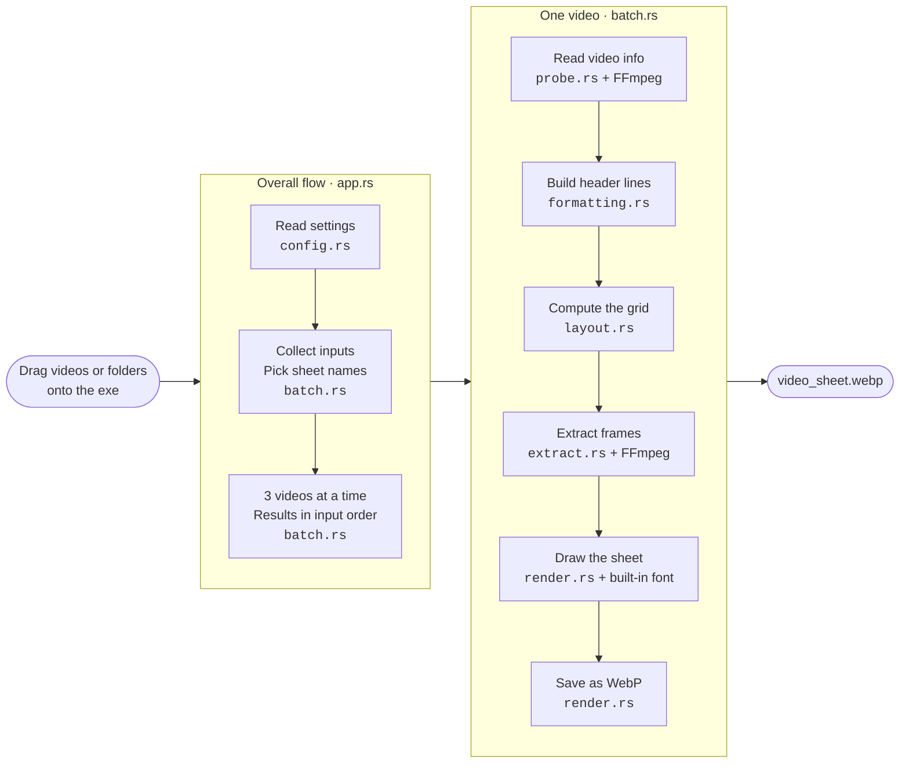

# VidGlance (Rust)

**English** | [한국어](README.ko.md)

A Windows tool that makes a **single-image thumbnail sheet** (`<video name>_sheet.webp`) next to a video when you drag the video onto `VidGlance.exe`. It is a Rust rewrite of the [Python VidGlance](https://github.com/0eti/VidGlance), with the same features and the same sheet layout.

- Video info at the top: file name, size, resolution (aspect ratio), fps, video and audio codecs, duration
- A 4×5 grid of frames below, with a timestamp in each cell
- Handles many videos and folders at once, including non-ASCII (e.g. Korean) file names and paths

Three things VidGlance holds to:

- **Universal:** Any extension, any codec. mp4, mkv, avi, mov, webm, ts and more, in H.264, HEVC, VP9, AV1 or anything else FFmpeg can read.
- **Simple:** One drag and drop and you are done. A single exe, no installer, no other programs.
- **Fast:** Faster than any other program that does the same job. See the [speed comparison](#speed-comparison) below.

Console messages and `--help` are in Korean. The `language` setting changes only the header labels on the sheet.

## Differences from the Python version

| | Python 0.1.1 | Rust 0.2.4 |
|---|---|---|
| Distribution | onefile 82MB, or onedir folder 210MB | **one 24MB exe** (FFmpeg, dav1d and fonts included, no other DLLs) |
| Startup | onefile about 4–5 s, onedir 0.3 s | **0.02 s** |
| One 4K AV1 video | onedir about 1.1 s | **about 0.3 s** |
| Five 4K AV1 videos at once | onedir about 5.4 s | **about 1.2 s** (3 at a time) |
| 1080p H.264, 60 s (keyframe every 8 s) | onedir about 2.6 s | **about 1.3 s** |
| 9.6GB fragmented MP4 (3 h 27 min) | onedir about 4.1 s | **about 1.2 s** |
| Settings file | `config.json` next to the exe | **always `%APPDATA%\VidGlance\config.json`** (never created next to the exe) |
| Video info | runs ffprobe.exe | read directly with the FFmpeg libraries inside the exe (no `ffmpeg_dir` setting or `--ffmpeg-dir`) |

A `config.json` from the Python version works as is when copied to `%APPDATA%\VidGlance\` (`ffmpeg_dir` is silently ignored). The timestamp position setting (`timestamp_position`) exists only in the Rust version.

## Usage

1. Put `VidGlance.exe` in any folder.
2. **Drag video files (one or more) or folders onto the `VidGlance.exe` icon.**
3. `<video name>_sheet.webp` appears next to each video. If everything succeeds, the window closes by itself after 3 seconds. If anything fails, it shows why and waits for a key press.

- Videos are processed 3 at a time, and results are shown in the order you dropped them.
- Videos that already have a sheet are skipped (change this with `overwrite`).
- If a folder has videos with the same name and different extensions (`a.mkv`, `a.mp4`), they become `a_sheet.webp`, `a_sheet(2).webp`… in name order. The names stay the same on every run, so sheets you already made are skipped. Dropping subtitles or photos with the same name (`a.ass`, `a.jpg`) along with them does not change the video's sheet name.
- When you drop a folder, only the videos in it (`mp4 mkv avi mov wmv flv webm m4v ts m2ts mpg mpeg 3gp`) are processed. Subfolders are included only when `recursive` is `true`.
- Files you drop directly are opened whatever their extension. Files that are not videos, such as subtitles, documents and photos, are skipped as "not a video" (`영상 아님`).
- **Double-click** the exe to see where the settings file is (it is created if missing).

> The exe is not signed, so Windows SmartScreen may appear on the first run. Click **More info → Run anyway**.

## Settings (`%APPDATA%\VidGlance\config.json`)

Type `%APPDATA%\VidGlance` in the File Explorer address bar to open the folder. Edit the file in Notepad and save; the change applies from the next run. To use another settings file, add `--config <path>`.

```json
{
  "config_version": 1,
  "columns": 4,
  "rows": 5,
  "width": 1024,
  "gap": 8,
  "theme": "light",
  "language": "en",
  "header": {
    "file_name": true,
    "size": true,
    "resolution": true,
    "fps": true,
    "video_codec": true,
    "audio_codec": true,
    "duration": true
  },
  "format": "webp",
  "quality": 85,
  "suffix": "_sheet",
  "output_dir": "",
  "overwrite": false,
  "show_timestamp": true,
  "timestamp_position": "bottom-right",
  "recursive": false,
  "skip_start_seconds": 0,
  "skip_end_seconds": 0,
  "seek_mode": "fast",
  "font": "",
  "close_delay_seconds": 3
}
```

| Key | Meaning | Allowed values |
|---|---|---|
| `columns`, `rows` | Grid columns and rows | 1–20 |
| `width` | Sheet width (px) | 320–8000 |
| `gap` | Space between cells (px) | 0–100 |
| `theme` | Light or dark background | `"light"` / `"dark"` |
| `language` | Header label language | `"en"` / `"ko"` |
| `header.*` | Whether to show each header item. All `false` gives the grid without a header | `true` / `false` |
| `format` | Output format | `"webp"` / `"jpg"` / `"png"` |
| `quality` | Compression quality (ignored for png) | 1–100 |
| `suffix` | Ending added to the output file name | Non-empty string without `< > : " / \ \| ? *` |
| `output_dir` | Output folder. Empty means the video's folder; a relative path is relative to each video's folder | Path |
| `overwrite` | Overwrite existing sheets | `true` / `false` |
| `show_timestamp` | Draw a timestamp in each cell | `true` / `false` |
| `timestamp_position` | Where the timestamp sits in a cell | `"bottom-right"` / `"bottom-left"` / `"top-right"` / `"top-left"` / `"center"` |
| `recursive` | Include subfolders when a folder is dropped | `true` / `false` |
| `skip_start_seconds`, `skip_end_seconds` | Seconds to leave out at the start and end | 0 or more |
| `seek_mode` | `fast` uses the keyframe nearest to each evenly spaced point (fast, usually 1–3 s off). If that keyframe is farther than half the cell spacing or 10 s, only that cell is taken at the exact point. `accurate` always uses the exact point (slow). Timestamps always show the actual frame time | `"fast"` / `"accurate"` |
| `font` | Font file path. Empty means Malgun Gothic, then the built-in Pretendard | Path |
| `close_delay_seconds` | Seconds before the window closes when everything succeeded. 0 closes at once; a negative value always waits for a key | Integer |

In JSON, write the `\` in Windows paths twice (`\\`) or use `/`: `"output_dir": "D:/thumbnails"`.

## Command-line options

Options override the settings for this run only. When run from a command line, the window does not wait at the end.

```
VidGlance.exe [options] <file or folder...>

  -g, --grid CxR         grid (e.g. 5x6)
  -w, --width PX
      --gap PX
      --theme THEME      light | dark
      --lang LANG        en | ko
  -o, --output-dir DIR
  -r, --recursive
      --format FMT       webp | jpg | png
      --quality N
      --overwrite
      --no-timestamp
      --font PATH
      --seek MODE        fast | accurate
      --config PATH      use this settings file
      --no-pause         do not wait at the end
  -q, --quiet            print the summary only
  -v, --verbose          print FFmpeg version, fonts and per-step times
  -V, --version
```

Exit codes: `0` all succeeded or skipped, `1` at least one failed, `2` settings error or invalid option.

## Speed comparison

Compared with other Windows programs that make thumbnail sheets, on the same videos and settings (2026-10-28).

- **Settings:** 4×5 grid, 1024px wide. Programs that cannot hit that exactly were set to the closest value (VTM 1023px, PotPlayer 1018px, vcsr 1051px).
- **Measured time:** From program start to the saved sheet, the faster of 2 runs. PotPlayer is the exception (see below).
- **PC:** Intel Core i5-9300HF (4 cores, 8 threads), 32GB RAM, SSD, Windows 11

| Video | Details |
|---|---|
| 4K AV1 | 3840×1920 23.98fps, 62–188MB, 5 videos (downloaded from YouTube) |
| H.264 60 s | 1920×1080 30fps test pattern, keyframe every 8.3 s |
| fragmented MP4 | 1920×1080 H.264 + AAC, 3 h 27 min, 9.6GB, 13,439 fragments with no index (broadcast recording) |

**Time per video (seconds, lower is faster)**

| Program | 4K AV1 (average of 5) | H.264 60 s | fragmented 9.6GB | Notes |
|---|---|---|---|---|
| **VidGlance (Rust) 0.2.2** | **0.23** | **1.33** | **1.09** | Saving as jpg: 0.18 / 1.20 / 1.01 |
| VidGlance (Python) 0.1.1 onedir | 1.10 | 2.70 | 4.06 | |
| mtn 3.5.0 (`-z -b 2 -D 0`) | 0.63 | 0.17 ※ | 1.78 | Keyframes only. Korean text in the header is garbled, no WebP output |
| mtn 3.5.0 defaults | 17.64 | 3.88 | 1.80 | Black-frame and edge checks are slow |
| vcsi 7.0.17 `--fast` | 7.31 | 3.65 | 41.4 | Runs ffmpeg once per cell |
| vcsi 7.0.17 defaults | 8.66 | 4.93 | 37.6 | |
| vcsr 0.6.0 (Rust port of vcsi) | 7.06 | 2.91 | 39.5 | About the same with `--fast` |
| ffmpeg 9.0.2 keyframes only + tile | 1.08 | 0.18 ※ | 29.3 | No header or timestamps |
| ffmpeg 9.0.2 `-ss` per cell | 8.98 | 3.67 | 33.7 | No header or timestamps |
| ffmpeg 9.0.2 full decode + tile | 37.6 | 1.35 | 739 | No header or timestamps |
| MPC-HC 2.8.4 (`/thumbnails`) | 6.08 | 6.99 | 8.89 | Launches the whole player and steps one frame per cell |
| Video Thumbnails Maker 28.0 | 11.99 | 5.29 | 34.97 | The free edition puts an ad in one cell; jpg quality 90 |
| PotPlayer (Create snapshot) | 1.61 + about 2.4 to open | 0.59 ※ + about 2.4 to open | 3.28 + about 5 to open | Menu only. Seeks by keyframe |

※ These use keyframes only. This video has just 8 keyframes, so at most 8 of the 20 cells show different scenes. When a keyframe is far away (more than half the cell spacing or 10 s), VidGlance takes that one cell at the exact point, so all 20 cells show different scenes.

- **PotPlayer measurement:** It can only be started from inside the program, so the time is from "starts reading the video after clicking OK" to "result file finished", with the time to open the video listed separately. While opening the fragmented video it read 7.7GB of the 9.6GB.
- **Why VidGlance is fast:**
  - It uses the FFmpeg libraries directly instead of launching a player or the ffmpeg program.
  - In fast mode it decodes a single keyframe per cell and scales it straight to cell size.
  - Cells within the same keyframe interval are decoded in one pass.
  - Multiple videos are processed 3 at a time.
  - Files are read with Rust's own file I/O. On Windows, FFmpeg's default file reading is more than 3 times slower at opening MP4s with many fragments.

## Structure



- Only `app.rs` handles output (console messages, waiting for a key, exit codes). The other modules return values or errors.
- Only `probe.rs` and `extract.rs` call FFmpeg. `layout.rs` only computes; it never reads or writes files.
- When there is just one video and its first cell lands on a keyframe, `extract.rs` splits the remaining cells across 4 threads.
- Sheets are written to a temporary file (`.<name>_sheet.webp.tmp`) and then renamed, so closing the window midway never leaves a broken sheet.

## Building

Requirements: Rust (MSVC), Visual Studio Build Tools (C++), LLVM (libclang), [vcpkg](https://github.com/microsoft/vcpkg).

```
# Static build of FFmpeg + dav1d (once, about 30 minutes)
vcpkg install "ffmpeg[core,avcodec,avformat,swscale,dav1d,zlib]:x64-windows-static-release" --overlay-triplets=vcpkg-triplets

cargo build --release      # → target/release/VidGlance.exe
cargo test                 # test videos: ../VidGlance/tests/_media (or the VIDGLANCE_MEDIA environment variable)
```

The vcpkg location is `VCPKG_ROOT` in `.cargo/config.toml` (default `D:\Dev\Tools\vcpkg`), and an environment variable overrides it. The VC++ runtime is linked statically too (`+crt-static`), so the exe runs on its own.

## License and notices

The VidGlance source code is under the [MIT License](LICENSE).

The distributed exe statically includes the libraries below, each under its own license.

| Component | Version | License | Source |
|---|---|---|---|
| FFmpeg (libavcodec, libavformat, libavutil, libswscale) | 9.0.2 | **LGPL v2.1 or later** (built without GPL features) | <https://ffmpeg.org/download.html> |
| dav1d (AV1 decoder) | 1.5.4 | BSD-2-Clause | <https://code.videolan.org/videolan/dav1d> |
| zlib | 1.3.2 | zlib License | <https://zlib.net> |
| libwebp (libwebp-sys) | | BSD-3-Clause | <https://chromium.googlesource.com/webm/libwebp> |
| Pretendard font | 1.3.9 | SIL Open Font License 1.1 (`assets/fonts/Pretendard-LICENSE.txt`) | <https://github.com/orioncactus/pretendard> |
| Rust crates (ffmpeg-next, image, ab_glyph, clap, serde_json, etc.) | | Mostly MIT or Apache-2.0 | `Cargo.lock` |

Because FFmpeg is linked statically, the LGPL lets you relink with another FFmpeg build using this repository's source and the build steps above ("Building"). FFmpeg is a trademark of Fabrice Bellard, originator of the FFmpeg project. VidGlance is not affiliated with the FFmpeg project.
